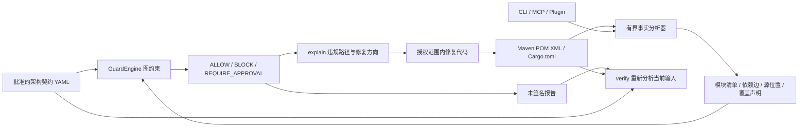

# 架构约束与检查闭环（0.2.0）

基础检查规格是 [add-maven-architecture-loop](../openspec/changes/add-maven-architecture-loop/)。工具负责采集构建声明，GuardEngine 负责规则判定，插件负责引导与调用同一实现。



## 可执行入口

以下命令假定已构建的 archguard 在 PATH 中。Windows 示例的项目是实际被检查的 Java 项目，而不是工具源码目录。

```powershell
archguard context --project E:\projects\orders
archguard contract validate --project E:\projects\orders
archguard check --project E:\projects\orders
archguard explain --project E:\projects\orders --rule DOMAIN-NO-INFRA
archguard check --project E:\projects\orders --report E:\reports\orders-001.json --facts E:\reports\orders-facts-001.json
archguard verify --project E:\projects\orders --report E:\reports\orders-001.json
```

默认契约 `.archguard/contract.yaml`；`--contract` 可指定其他文件。工具不会自动生成规则。单一 pom.xml 或 Cargo.toml 自动识别；混合根目录显式传 `--analyzer maven|cargo`。check 始终向 stdout 输出 JSON；导出只新建文件，父目录须存在，已有输出不覆盖。verify 的 --report 是输入。

退出码：0 ALLOW、2 BLOCK、3 REQUIRE_APPROVAL、4 参数/输入错误或过期报告。INDETERMINATE 一律 BLOCK，包括 advise。REVIEW 不等于批准。

## 契约

参考 [Maven 示例](../examples/maven-layered-contract.yaml)。Maven 节点 ID 是 groupId:artifactId，Cargo 是包名。

| 类型 | 语义 | 证据 |
|---|---|---|
| forbid_relation | 禁止指定直接声明依赖 | 实际匹配边 |
| forbid_path | 禁止经一条或多条边到达指定模块 | 确定性的最短见证路径 |
| allowed_dependencies | subject 的直接依赖只能在 objects 内 | 越界边；空清单禁止所有出边 |
| require_relation | 必须存在指定直接依赖 | 缺失时 FAIL，规则本身指明缺失关系 |
| acyclic | 指定谓词图不得有环 | 一个实际闭合环，不保证枚举所有环 |

v1alpha2 必须使用显式 coverage（entities、predicates、scope）。规则拼错实体、请求未支持关系或缺少覆盖，不能因为没有匹配边而通过。旧 v1alpha1 只支持精确 forbid_relation，保留历史行为；迁移严格覆盖需显式升级契约版本。

## 分析范围与边界

Maven 支持 4.0.0/4.1.0 模型命名空间、modules/module 和 subprojects/subproject、本地父 POM 继承、属性递归展开、直接与继承依赖、直接 dependencyManagement 版本。dependencyManagement 本身不产生依赖边。测试、可选、provided 等声明均计入；这里是声明图，不是某个激活配置的运行期类路径。

缺失模块、外部/越界父 POM、无法展开属性、未显式选择的模型 profiles、版本歧义、重复坐标或模块声明、DTD、混合命名空间和链接路径产生 partial。Maven 不启动构建，不下载依赖。jvm.config 仅支持数值 Xmx/Xms/Xss 内存参数；其他 JVM 参数、maven.config、extensions.xml 需要后续有效模型适配器。最多 1024 个输入文件、64 层模型、单文件 4 MiB、总输入 64 MiB。

Cargo 保留本地成员 path 声明依赖，使用 `cargo metadata --no-deps --offline --locked --format-version 1`。覆盖含普通/开发/构建/可选/目标条件声明，未解析外部传递调用。失败时阻断；不会为检查更新锁文件。

0.3.0 的原生规格绑定与显式 profile 扩展见 [方法整合](method-integration.md)。

当前不支持 Java import/包与类型边界、方法调用/反射、DDD 聚合状态不变量、外部有效依赖解析、审批存储和签名证明。未调用 CodeGraph 构建新索引。

## CLI、MCP 与插件

MCP 暴露 archguard_context、archguard_instructions、archguard_check、archguard_explain、archguard_verify。专业工具要求显式绝对 project；可选 contract、verify 的 report 也必须绝对。explain 必须提供 rule。MCP 不接受报告/事实导出路径。BLOCK 是领域结果，非协议错误。

[插件包](../plugin/) 遵循 Agent Plugins 1.0.0：manifest、MCP 配置、architecture-check 技能。0.3.0 插件需要 PATH 上存在 0.3.0 CLI；包不含二进制。原生 Codex/Claude/Gemini 安装仍由 CLI install 提供。安装提示动态摘要当前默认契约；未配置和无效规则明确显示；安装和 context 不执行领域检查。

## 报告与可信性

报告绑定契约内容、引擎/分析器版本、事实、实际读取文件摘要。verify 重新读取当前构建输入和契约，再逐字段比对报告；旧报告、篡改判定、signed 或源变化均被拒绝。Java 源码改动不在 POM 声明图快照范围内。升级引擎或分析器后应重新生成报告。

报告未签名；当前服务不是针对恶意并发文件替换的操作系统沙箱。可信 CI 必须使用固定提交、受保护契约和可信工具，在独立工作区重新分析。GuardEngine verify 只证明给定契约/事实一致性，ArchGuard verify 才重新采集源输入。

## 实际项目诊断

2026-10-15 对本地 ddd4j 当前工作区运行只读诊断契约（全图无环，临时契约不写入 ddd4j）。仅 -Xmx1024m 的 jvm.config 已支持；随后在 ddd4j-parent/pom.xml 检测到影响模型的 profile，返回 INDETERMINATE/BLOCK。此结果是覆盖不足，不是发现循环，也不是 ddd4j 架构已验收。下一优先项是有明确激活参数和来源证据的 Maven effective-model 适配器。
