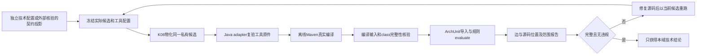

# Java 字节码架构检查（EG-A01）

规格事实源仍为现有 `add-engineering-guard-core` 的 EG-A01 / EG-ARCH-001。本页说明实现边界，不新增批准或替代规格。EG-A01 的最小独立产品闭环已取得本地独立复验与 Ubuntu/Windows CI 证据，不表示完整领域/方法或生产发布路线已经完成。

旧 check/explain/verify、项目模型、需求增量、Cargo 和 Maven 静态检查保持原语义。新能力显式使用 bytecode check|verify，执行编译而非静默改变旧命令副作用。

ArchGuard 拥有 Java adapter 和架构参数解释，GuardCore 不持有分层规则。适配器固定 ArchUnit 1.5.1，通过 ClassFileImporter 导入明确的本次编译目录并实际调用 ArchRule.evaluate；报告包含规则、实际依赖边、源码位置和覆盖。首批仅支持精确包前缀禁止边，不推断领域不变量、反射调用或合理职责。

生产组合入口只能从外部受信端口核验后的 CompiledContract 投影参数，不能从普通 JSON 的 approved 字段获得信任。独立入口返回本域本地技术结论，不签发授权或推进流程。规则配置、Java/Maven/ArchUnit/helper 字节身份和当前候选均须绑定；普通技术配置不是批准证据。

编译和检查使用同一个已 pin 的原生 Java adapter，在 K06 Runtime::execute_v2 的同一私有候选目录完成。Java adapter 启动固定 Java/Maven 子进程，完整进程树和总预算由公共 runtime/runner 管理，不实现替代超时执行器。不得读取原仓 target 或把两次独立物化运行的产物视为同一次编译。

缺少工具、编译失败、缺失预期项目类、空选择、损坏 class、重复全限定名、未解析的项目类型或导入异常均为 incomplete，不以零违规冒充通过。JDK/外部依赖解析范围明确声明；ArchUnit 默认缺类占位机制不能成为完整性证明。输入清单和源码/字节码摘要绑定本次编译；verify 必须在当前候选重新编译和评估，拒绝旧报告或旧产物。

验收计划：真实 Maven 多模块合法依赖、禁止边及源码位置、不完整输入、损坏/缺失类、空层、修复复验和报告漂移；Rust 1.85 及旧 Cargo/CLI 回归。当前使用已安装 JDK 17，不宣称 JDK 8 或其他平台已验收。所有开发缓存与产物放 E 盘。

Java adapter 已真实通过 19 项测试，Rust 产品入口、契约投影、公共 runtime 接线及修复复验已有本地独立和 Ubuntu/Windows CI 验证，详见 [本批验证记录](verification-bytecode.md) 和 [适配器边界与协议](../java-adapter/README.md)。当前版本为 0.6.0 候选；本任务验收不代表完整路线、签名发布或真实宿主集成完成。独立运行的技术配置不能自行生成 CompiledContract 或受信批准。

插件的 architecture-check 技能及安装时注入的提示已经说明 bytecode check/verify 的使用条件。现有 MCP 操作保持只读；新字节码入口通过显式 CLI 编译，或通过库的 check_registered_result 组合已批准契约及冻结计划。普通模型检查不会隐式启动 Maven，也不会自动把字节码结果写成新的项目基线。

本地命令需要明确 --project、--scratch、--store、--config、--policy、--subject、--base 和唯一 --operation；commit 候选额外提供 --commit。首次 check 可用 --report 写新收据；修复后 verify 额外提供 --previous，保持相同配置、规则、选择类型及基线，并使用新 operation。详细步骤见[插件工作流](../plugin/skills/architecture-check/references/bytecode.md)。本地 CLI 退出0表示技术完整且无违规；退出2包括违规或不完整，必须读取收据 status；参数及旧收据错误退出4。它们均不代表交付批准。
