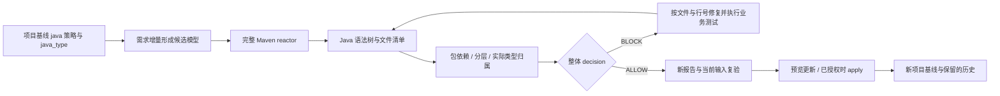

# Java 源码包依赖、分层与领域归属（0.5.0）

ArchGuard 在项目模型中显式启用 Java 策略，复用已有基线、需求增量、检查、修复复验和发布指针。没有 Java 策略的旧模型与 Cargo 项目维持原有能力；不会自动开启新门禁。



## 项目模型

完整示例：[java-project-model.json](../examples/java-project-model.json)。在原模型根增加：

```json
"java": {
  "packages": [
    {"prefix":"io.demo.domain","module":"app","layer":"domain"},
    {"prefix":"io.demo.infra","module":"app","layer":"infra"}
  ],
  "layers": [
    {"id":"domain","allowed_dependencies":[]},
    {"id":"infra","allowed_dependencies":["domain"]}
  ],
  "forbidden_dependencies": [
    {"id":"NO_SQL","from":"io.demo.domain","to":"java.sql"}
  ],
  "include_tests": false
}
```

同模块也可以定义多个层。包前缀按点边界匹配，`io.demo.domain` 不匹配 `io.demo.domainx`；嵌套前缀取最长项，重复前缀拒绝。所有扫描到的包都须有映射，module 是模型稳定 ID，必须与该文件真实 reactor 模块相同。模型模块仍通过 implementation 映射 Maven 坐标。

同层引用允许；跨层仅允许 allowed_dependencies 中的方向。未映射的外部包不参与分层允许表，但仍参与显式禁止包规则。配置未知层、重复规则 ID 或未知模块会直接报错。

启用 Java 后，每个 aggregate/entity/value_object/interface/event 必须有 java_type，例如：

```json
{"id":"Order","kind":"aggregate","name":"Order","responsibility":"订单生命周期","context":"sales","module":"app","java_type":"io.demo.domain.Order"}
```

类型需在源码唯一声明，且实际模块和包映射归属与模型一致。支持 class/interface/enum/record/annotation 类型及成员嵌套类型（例如 `io.demo.domain.Order.Item`）；局部或匿名类不作为领域对象声明。归属检查不验证聚合行为或 Java 类型是否实现领域不变量。

## 增量与命令

已有基线通过 `.archguard/changes/ID.json` 的可选 java 字段替换整个策略，通过 upsert_elements 更新 java_type。省略 java 或写 null 不关闭既有策略。策略变化保守影响全部模块；其余需求仍须绑定当前 base_digest 和真实原生规格。

```text
archguard model validate --project PROJECT --model MODEL_FILE
archguard baseline init --project PROJECT --model MODEL_FILE
# 已授权初始化时追加 --apply
archguard change impact --project PROJECT --change REQ-ID
archguard change check --project PROJECT --change REQ-ID
# 按 findings 修复后，运行实际业务测试，再生成新报告
archguard change check --project PROJECT --change REQ-ID --report NEW_REPORT
archguard change verify --project PROJECT --change REQ-ID --report NEW_REPORT
archguard baseline update --project PROJECT --change REQ-ID --report NEW_REPORT
# 已授权更新时追加 --apply
```

PROJECT 必须绝对路径。新增功能沿用现有 CLI 和 10 个只读 MCP，不增加写 MCP。完整模型工作流和路径规则见 [项目模型指南](project-model.md)。

## 报告与修复

候选报告增加 java_analysis：complete、source_digest、files、modules、include_tests、edges 和 findings。依赖边包含 from/to/file/line；findings 包含以下分类：

| code | 含义与修复依据 |
|---|---|
| java_layer_violation | 跨层引用不在允许表中；按源码位置重构依赖 |
| java_forbidden_dependency | 命中禁止包规则，附 rule ID |
| java_unmapped_package | 实际源码包未纳入项目模型，需要核对设计与源码 |
| java_package_owner_mismatch | 源码实际模块与包映射不一致 |
| java_missing_domain_type | 模型引用的领域类型在扫描范围内不存在 |
| java_domain_owner_mismatch | 类型实际模块与领域对象所属模块不一致 |
| java_analysis_incomplete | 解析、重复声明、路径或覆盖问题；不得作为通过 |

complete=true 只说明已完成声明范围提取，仍须查看 findings 和顶层 decision。architecture_report 是构建子报告，它的 ALLOW 不能盖过 Java BLOCK。普通 check 将 Java 证据绑定事实摘要，失败通过 INDETERMINATE/BLOCK 和诊断展示；候选 change check 提供结构化 Java 细节。

修复由智能体在授权范围内完成，不存在自动改写业务源码的 fix 命令。不能通过禁用策略或删除映射掩盖违规。每次源码内容、文件新增/删除、策略、类型映射、原生规格变化都需重新检查；基线更新在既有锁内重新计算证据。

## 分析范围

- 使用固定版本 [Tree-sitter Java 0.23.5](https://docs.rs/tree-sitter-java/0.23.5/tree_sitter_java/) 和 Tree-sitter 0.25.10，不执行 Maven 插件或 javac。
- 扫描所有 reactor 模块的 src/main/java；include_tests=true 时加入 src/test/java。默认测试源码明确排除。
- 语法依赖覆盖导入、静态导入、通配导入、可识别项目全限定类型/成员引用和包注解。通配导入保守视为依赖该包，未使用导入仍是声明依赖。
- 外部全限定引用匹配显式禁止前缀时保守纳入；变量遮蔽不做编译器解析，可能需人工判断。未配置的外部全限定引用不会自动构成完整外部依赖图。
- 注释与普通字符串不产生依赖；合法转义 Windows 路径不会误判为 Unicode 转义。
- JPMS、自定义 sourceDirectory/testSourceDirectory、已识别生成源码配置/产物、有效 Unicode 转义、语法错误、重复全限定类型、内部未解析导入、空源码集合均阻断。该静态工具不推断任意 Maven 插件运行后新增的源根。
- 路径链接和项目外文件拒绝；输入最多 1024 个文件（含 POM）、单文件 4 MiB、输入总量 64 MiB；目录深度 64、目录遍历 8192，单文件语法树 200000 节点、深度 256，在提取限定名之前校验预算。
- 这不是完整编译器依赖图：简单名消歧、类型推导、继承导致的隐式类型引用、注解生成、反射、动态调用和业务不变量仍需编译/测试或后续分析器。Cargo 源码语义未扩展。

可选字段在旧模型省略时不参与序列化，保持旧基线模型的摘要格式；升级分析器后旧检查报告须重新生成。历史快照不被改写。
