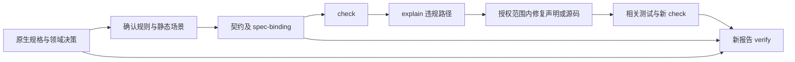

# 架构方法、原生规格与检查闭环（0.3.0）

唯一增量规格：[integrate-architecture-methods](../../guardengine/openspec/changes/integrate-architecture-methods/)。本指南描述当前已实现入口；完整 Maven effective model 和 Java 源码语义属于后续能力。

## 插件技能与维护源

插件在原有 architecture-check 之外提供五项方法：archguard-domain-modeling、archguard-grill-with-docs、archguard-codebase-design、archguard-improve-codebase-architecture、archguard-research，并打包 guard-grilling 依赖。名称加前缀，避免误用全局同名技能。

方法源码和锁文件在 [GuardEngine 公共库](../../guardengine/skill-library/README.md)。固定 Matt Pocock 1.3.1 的完整提交、MIT 许可与逐文件摘要；原始来源仅溯源，适配版才在 skills/ 下被发现。grill-with-docs 与 improve-codebase-architecture 保留手动调用属性，宿主不支持该元数据时遵守正文限制。

生成器离线校验缺失/循环依赖、输入摘要、包内引用、路径与人工修改冲突；重复生成无变化。不要直接编辑生成文件。包校验与子进程 MCP 测试不等于任何真实宿主已经安装或加载。

## 原生规格选择

```powershell
archguard spec context --project E:\projects\orders
archguard spec context --project E:\projects\orders --spec-system openspec --spec-target openspec/changes/order-boundary
archguard context --project E:\projects\orders --spec-system speckit --spec-target specs/001-orders
```

六个 Guard 的共享接入层都提供 spec context 和 context.specification。现有 MCP 的 `<guard>_context`、`<guard>_instructions` 可接收可选 spec_system/spec_target，不新增重复的规格服务。

| 体系 | 识别标志 | 目标与必要产物 |
|---|---|---|
| OpenSpec | openspec/ | 非 archive 的 changes/<change>：proposal、design、tasks、specs/*/spec.md |
| Spec Kit | .specify/ | specs/<feature>：spec、plan、tasks；.specify/memory/constitution.md |
| 已有 Superpowers | docs/superpowers/specs/ | 显式或唯一的规格 Markdown；同文件名 plans 文件存在时纳入摘要 |

不根据已安装 CLI 判断项目体系。无体系返回 unconfigured；多体系/目标返回 ambiguous；缺文件或空文件返回 incomplete。普通 specs/ 不能单独证明 Spec Kit。读取最多 128 个产物、单文件 1 MiB、合计 8 MiB；拒绝链接路径。

该适配器不理解全部自定义 SDD schema，不判断语义正确、任务完成或批准。Superpowers 不同名 plan 不自动猜测关联。按项目原生流程编辑这些文件并执行原生验证，不创建第二份规格。

## 规则到规格的绑定

可选 `.archguard/spec-binding.json`：

```json
{
  "system": "openspec",
  "target": "openspec/changes/order-boundary",
  "rules": {
    "DOMAIN-NO-INFRA": {
      "artifact": "openspec/changes/order-boundary/specs/layers/spec.md",
      "requirement": "REQ-ARCH-1"
    }
  }
}
```

契约有多少规则就必须映射多少条，无遗漏或额外项。artifact 必须在所选原生产物中，requirement 完整文本标识必须存在（REQ-1 不匹配 REQ-10）。它记录来源，不证明规则等价于需求，也不授予批准。

绑定开启后，事实快照额外包含绑定文件与所选原生产物摘要。源码、契约、绑定、规格或分析器版本变化均使旧报告失效。未配置绑定的旧 Maven/Cargo 项目保持兼容，不强制初始化 SDD。

## Maven 显式 profile 场景

在 `.archguard/maven.json` 声明场景：

```json
{"profiles":{"integration":true,"legacy":false}}
```

所有影响模型的 profile 都必须选 true/false。选中 profile 的 properties、dependencies、dependencyManagement、modules/subprojects 按 POM 声明顺序合并。配置纳入源快照；未知 ID、重复 profile ID、未选择、错误字段或类型均阻断。即使 POM 声明 activeByDefault/JDK/OS 激活，也不能在没有明确场景时自动放行。

这是静态声明场景，并不等价于实际 Maven 的环境/settings/扩展激活求值。仍不下载依赖、不执行 Maven、不解析外部父/BOM，不支持 Java import/类型/方法调用。真实复杂项目遇到未覆盖项仍然 BLOCK/INDETERMINATE；不允许通过随意禁用 profile 获取通过结果。

profile 继承效果和同一 POM 后声明 profile 优先的语义参照 [Maven 官方 profile 文档](https://maven.apache.org/guides/introduction/introduction-to-profiles.html#profile-order)。该参考不扩大本分析器的覆盖声明。

## 修复复验



```powershell
archguard contract validate --project E:\projects\orders
archguard check --project E:\projects\orders
archguard explain --project E:\projects\orders --rule DOMAIN-NO-INFRA
# 修复实际违规，再执行相关测试；不修改已确认规则和场景来绕过检查。
archguard check --project E:\projects\orders --report E:\reports\orders-fixed.json
archguard verify --project E:\projects\orders --report E:\reports\orders-fixed.json
```

输出文件必须尚不存在。MCP 对应 archguard_check、archguard_explain、archguard_verify，共用相同实现；输入 project/report/contract 使用绝对路径。0=ALLOW、2=BLOCK、3=REQUIRE_APPROVAL、4=输入错误或旧报告。修复前证据不能用于修复后的代码。报告未签名，可信 CI 需在固定源码与受保护契约上重新运行。

相关回归：tests/architecture_loop.rs 检查 profile 违规/修复/场景漂移、原生规格变化、精确需求引用、CLI/MCP 一致性；tests/integration.rs 保留 Cargo 正负例。
