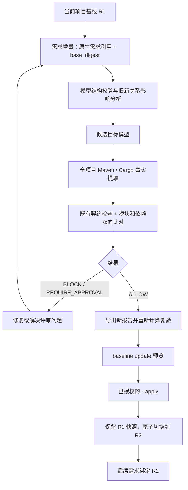

# 项目架构基线、需求增量与复验（0.4.0）

0.5.0 增量：模型可配置 java 策略及领域元素 java_type；省略时兼容本文原模型，配置后的源码检查范围见 [Java 源码指南](java-source.md)。下文涉及 Java 未覆盖的说明描述 0.4.0 能力，不包括新增的语法包依赖及声明类型归属检查。

项目长期维护一套架构和领域模型，每个需求只声明相对于该基线的变化。目标模型与实际 Maven/Cargo 声明分开维护，检查后才能显式推进本地基线。



## 文件与职责

```text
.archguard/
  contract.yaml                 # 项目可执行架构约束
  maven.json                    # 可选：显式 profile 场景
  spec-binding.json             # 可选：契约规则与原生规格绑定
  baseline.json                 # 当前基线的摘要指针
  baselines/<sha256>.json        # 不可变历史版本，包含模型、父版本、证据摘要
  changes/REQ-POINTS.json        # 需求增量，引用基线及原生需求
```

`baseline.json` 只有 schema_version=1 和 digest；模型位于所指向的快照。快照保存 revision、parent、model、contract_digest、change_id、change_digest、report_digest。使用 `model show` 获取完整目标模型；增加 `--entity ID` 读取一跳邻域，适合分步加载智能体上下文。邻域是只读视图，不可拿来覆盖完整模型。

首次采用可从已有架构设计整理一个模型输入文件，再校验、预览、初始化。不能把扫描现状自动当成正确架构。需求正文和验收标准继续保存在已有 OpenSpec / Spec Kit / Superpowers 中，ArchGuard 只保留引用。

## 模型格式

完整示例：[项目模型](../examples/project-model.json)。简化结构如下：

```json
{
  "schema_version": 1,
  "project": "sales-project",
  "elements": [
    {"id":"sales","kind":"context","name":"Sales","responsibility":"销售领域"},
    {"id":"domain","kind":"module","name":"Domain","responsibility":"领域规则","context":"sales","implementation":"io.demo:domain"},
    {"id":"Order","kind":"aggregate","name":"Order","responsibility":"订单生命周期","context":"sales","module":"domain"}
  ],
  "relations": []
}
```

这段简化模型仅适合对应单模块，实际模型必须覆盖分析器发现的全部模块，Maven 聚合根若被提取也需要建模。

| 模型项 | 约定 |
|---|---|
| 根字段 | schema_version、project、elements、relations；未知字段拒绝 |
| 元素身份 | id 唯一，1–128 字节，ASCII 字母/数字/点/横线/下划线，不能是 `.` 或 `..` |
| 元素类型 | context、module、capability、aggregate、entity、value_object、interface、event |
| 元素说明 | name、responsibility 必填且非空 |
| 上下文 | context 元素不能再声明所属上下文/模块；其他元素必须引用有效 context |
| 模块 | implementation 必填且唯一，Maven 为 groupId:artifactId，Cargo 为包名 |
| 领域对象 | 除 capability 外，非 context/module 元素必须归属模块，且与模块上下文相同 |
| 关系 | id/from/to/kind；ID 唯一且不能与元素 ID 重复，端点必须存在 |
| 关系类型 | depends_on 只连接模块；uses 表示声明使用；publishes/subscribes 的目标须为 event |

depends_on 表示目标内部模块依赖，候选检查与实际声明边双向比较：实际新增而未建模的依赖、模型要求而实际不存在的依赖都会阻断。循环、分层等全局规则继续由项目 contract.yaml 定义；模型关系不是自动生成的宽松白名单。

领域对象的归属与关系属于确定性声明检查，不表示 Java 源码中的类、事件处理、聚合不变量或方法行为已验证。

## 需求增量格式

示例：[需求增量模板](../examples/requirement-change.json)。将 base_digest 替换为当前 model show 返回的 digest，并使用实际存在的原生需求引用。

```json
{
  "schema_version": 1,
  "id": "REQ-POINTS",
  "base_digest": "sha256:当前基线摘要",
  "requirement": {
    "system": "openspec",
    "target": "openspec/changes/points",
    "artifact": "openspec/changes/points/specs/orders/spec.md",
    "requirement": "REQ-POINTS"
  },
  "upsert_elements": [
    {"id":"Points","kind":"entity","name":"Points","responsibility":"积分状态","context":"sales","module":"domain"}
  ],
  "remove_elements": [],
  "upsert_relations": [{"id":"order-points","from":"Order","to":"Points","kind":"uses"}],
  "remove_relations": [],
  "touched_modules": ["domain"]
}
```

增量 ID 必须等于文件名，必须绑定当前基线。upsert 使用稳定 ID；remove 不能删除未知 ID；同一 ID 不能重复或同时删除/更新。删除后存在悬空关系将失败。结构不变的实现需求使用 touched_modules，内容为稳定模型模块 ID，不是 Maven 坐标。

原生来源必须 ready，artifact 必须属于选定产物，requirement 完整标识必须存在；这些检查只验证引用，不批准需求。所有原生产物摘要进入报告，修改原生计划等文件也会使旧报告失效。已有 `.archguard/spec-binding.json` 继续独立约束规则引用。

## CLI 闭环

下面的 PROJECT 必须是绝对目录，输入模型和报告必须位于该项目内。模型工作流中的相对文件路径统一以 PROJECT 为基准，报告父目录须已存在；外部绝对报告路径会在写入前拒绝。短命令要求二进制在 PATH；源码构建可使用 target/debug/archguard.exe 的完整路径。

```text
archguard model validate --project PROJECT --model MODEL_FILE
archguard baseline init --project PROJECT --model MODEL_FILE
# 审阅结果并具备本地写入授权后才执行：
archguard baseline init --project PROJECT --model MODEL_FILE --apply

archguard model show --project PROJECT
archguard model show --project PROJECT --entity Order
# 在 .archguard/changes/REQ-POINTS.json 维护需求增量后：
archguard change impact --project PROJECT --change REQ-POINTS
archguard change check --project PROJECT --change REQ-POINTS
# 根据 model_findings / architecture_report 修复，然后运行适用业务测试：
archguard change check --project PROJECT --change REQ-POINTS --report NEW_REPORT
archguard change verify --project PROJECT --change REQ-POINTS --report NEW_REPORT
archguard baseline update --project PROJECT --change REQ-POINTS --report NEW_REPORT
# 预览通过且已授权后：
archguard baseline update --project PROJECT --change REQ-POINTS --report NEW_REPORT --apply
archguard check --project PROJECT
```

混合 Maven/Cargo 根在 check/verify/init/update 中显式加 `--analyzer maven|cargo`。模型工作流固定使用项目 `.archguard/contract.yaml`，需要 v1alpha2；不能通过临时 `--contract` 换成更宽松的规则。基线绑定契约摘要，本版本不自动迁移契约；不要手改历史快照绕过检查。

模型 validate 和 impact 返回成功只说明结构/影响分析完成，不能替代 change check。change check 始终全项目检查，影响范围不会成为跳过全局循环/边界检查的理由。

| 结果 | 退出码 | 行为 |
|---|---|---|
| ALLOW | 0 | 当前声明范围检查通过；不是语义或审批通过 |
| BLOCK | 2 | 模型/实际依赖不一致、契约违规或覆盖不足 |
| REQUIRE_APPROVAL | 3 | 存在既有契约的 review 规则结果；工具不代为批准 |
| 错误 | 4 | 参数、模型、原生引用、陈旧基线/报告、锁或 I/O 错误 |

普通 check 在没有模型基线时行为不变；有基线时把摘要绑定到事实，若不能证明模型与实际图一致，事实覆盖设为 partial，规则 INDETERMINATE 并 BLOCK。需求开发以 change check 的候选模型为准；基线正式推进前，普通 check 可能正确地提示当前实现偏离旧基线。

## 影响解释与修复

影响计算在旧/新关系和 context/module 归属联合图上双向传播，包含被删除对象的旧邻居。affected_elements/modules/contexts 为完整可达范围；paths 最多 128 条，每条最多 64 个节点，截断时 witnesses_truncated=true。predecessors 保留完整 BFS 前驱，可重建路径。该策略保守，可能扩展到整个项目，不是精确源码调用影响。

model_findings 区分 unmodeled_module、missing_module、unmodeled_dependency、missing_dependency 和 incomplete_build_analysis。已有违规边提供 POM/Cargo 源位置；契约规则的路径见证位于 architecture_report，可继续使用 explain。先确认目标模型与需求一致，再修复实现；不要为了通过检查删除原有约束或扩大依赖范围。

## 更新保护与可信边界

初始化不能覆盖已有基线。更新默认只预览；`--apply` 先独占创建 `.baseline.lock`，重新读取并检查当前输入，只有匹配的 ALLOW 报告才允许创建快照、原子替换指针。旧版本和需求增量继续保留；第二个仍绑定旧版本的需求必须重新审阅，工具不自动重基。

报告仅允许新建，不能写入 baseline.json 或 baselines/changes 状态目录。变更报告和快照采用有界文件读取；单输入/快照最多 4 MiB，模型最多 10000 个元素、20000 条关系。异常写入可能留下未被指针引用的快照；不会自动删旧版本或用户文件。残留锁不自动强行清除，应先确认没有运行中的写入。

锁协调本 CLI 写入，并不是跨进程文件系统隔离；不保证恶意并发替换、所有外部编辑器协同或掉电后的完整持久性事务。CI 应固定候选 checkout 和受保护契约/基线。哈希不是签名，显式本地更新也不是人工审批或交付授权。

第一版物理存储为有界 JSON 快照，逻辑上按上下文、模块和稳定 ID 组织。物理分片、多项目联合、Java 类/方法语义、自动 EA/XML 交换及契约迁移仍未实现。Maven 保留已有静态解析及显式 profile 限制，Cargo 保留 offline locked metadata 范围。

## MCP 与插件

新增只读 MCP：archguard_model_show、archguard_model_validate、archguard_change_impact、archguard_change_check、archguard_change_verify。参数同名 project/entity/model/change/analyzer/report，project/model/report 必须为绝对路径；check 不接受报告输出路径，verify 仅读取已有报告。没有 baseline init/update MCP。

插件 architecture-check 与五项公共方法都引用项目模型流程；维护公共源后通过依赖锁生成包，不修改生成副本。包结构和真实 stdio 测试通过不等于某个宿主已加载。

正式规格：[project-model-baseline](../openspec/changes/project-model-baseline/)。
